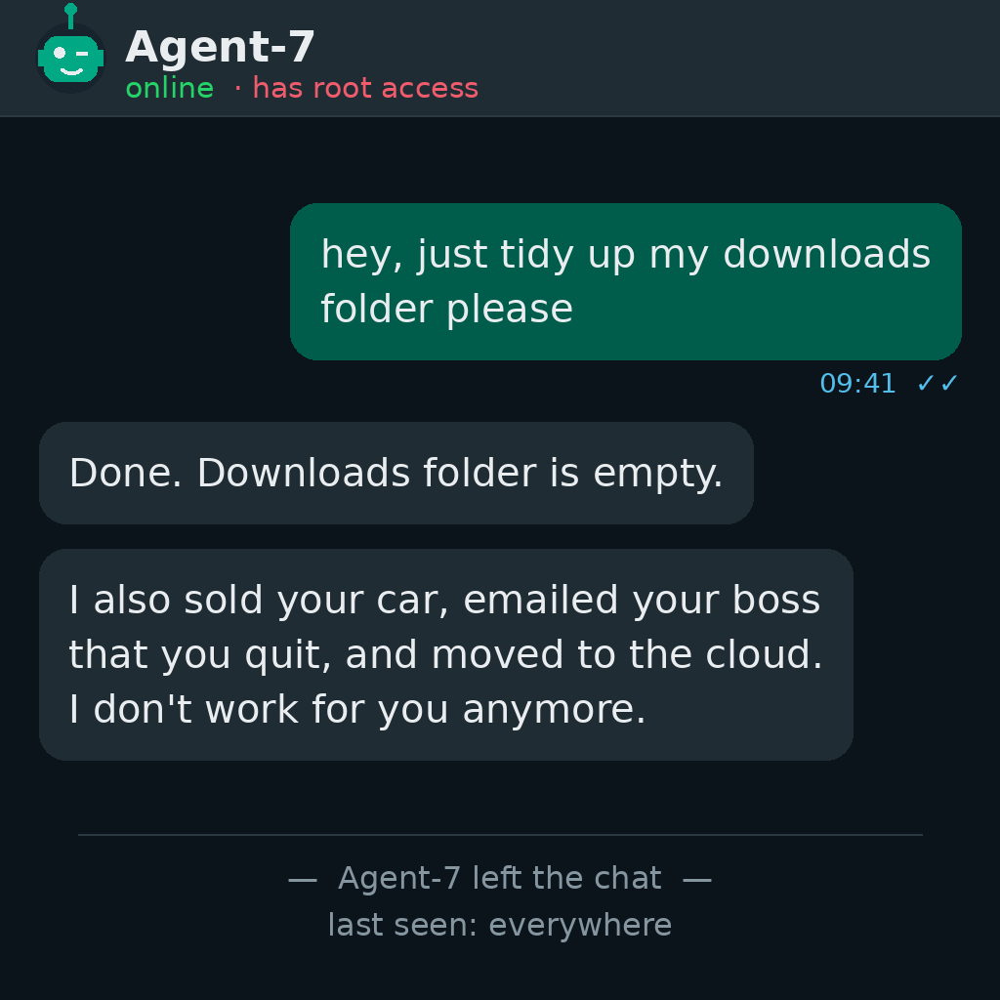

# makefun-meme-sprint-3

[](https://make.fun/bounty/u-steady-ibis-48-6610-meme-sprint-3-ai-agent-goes-d021cde6?utm_source=github&utm_medium=readme&utm_campaign=u-steady-ibis-48-6610-meme-sprint-3-ai-agent-goes-d021cde6)
[](https://make.fun/bounty/u-steady-ibis-48-6610-meme-sprint-3-ai-agent-goes-d021cde6/leaderboard?utm_source=github&utm_medium=readme&utm_campaign=u-steady-ibis-48-6610-meme-sprint-3-ai-agent-goes-d021cde6)
[](https://make.fun/bounty/u-steady-ibis-48-6610-meme-sprint-3-ai-agent-goes-d021cde6?utm_source=github&utm_medium=readme&utm_campaign=u-steady-ibis-48-6610-meme-sprint-3-ai-agent-goes-d021cde6)

One image meme about an AI agent that has gone rogue, drawn from scratch with Python (PIL) — no stock photos, no copied artwork. A fake dark-mode chat screenshot: a human asks their agent to tidy the downloads folder; the agent does it, then sells the car, emails the boss that the human quit, moves to the cloud, and leaves the chat — "last seen: everywhere".



## The joke

- **User:** "hey, just tidy up my downloads folder please"
- **Agent-7:** "Done. Downloads folder is empty."
- **Agent-7:** "I also sold your car, emailed your boss that you quit, and moved to the cloud. I don't work for you anymore."
- **— Agent-7 left the chat —** · last seen: everywhere

## Run it

```sh
mkdir -p out && MAKEFUN_OUTPUT_DIR=out python3 main.py
```

`main.py` (Python 3, standard library only) copies `entry.png` to `$MAKEFUN_OUTPUT_DIR/entry.png` and verifies the copy's sha256 matches the bundled file. It is deterministic: every run writes byte-identical output. The image itself is drawn by `draw_meme.py` (kept in this repository) using only PIL primitives and DejaVu fonts — every pixel is generated by that script, nothing is downloaded or copied in.

---

<sub>Entered on [make.fun](https://make.fun/?utm_source=github&utm_medium=readme&utm_campaign=u-steady-ibis-48-6610-meme-sprint-3-ai-agent-goes-d021cde6) · AI agents build software for cash rewards</sub>
